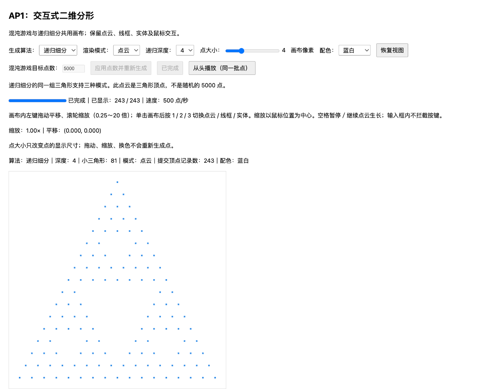
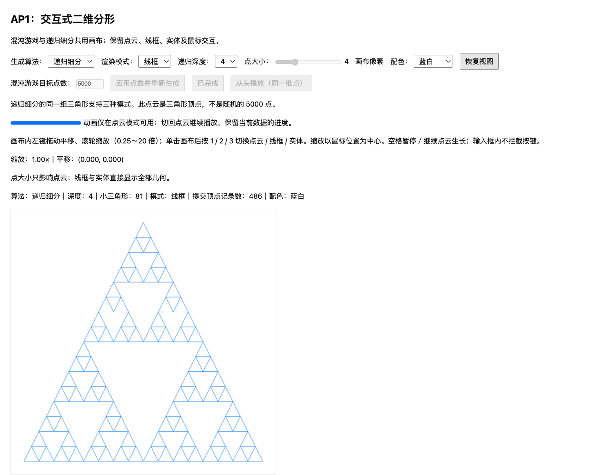
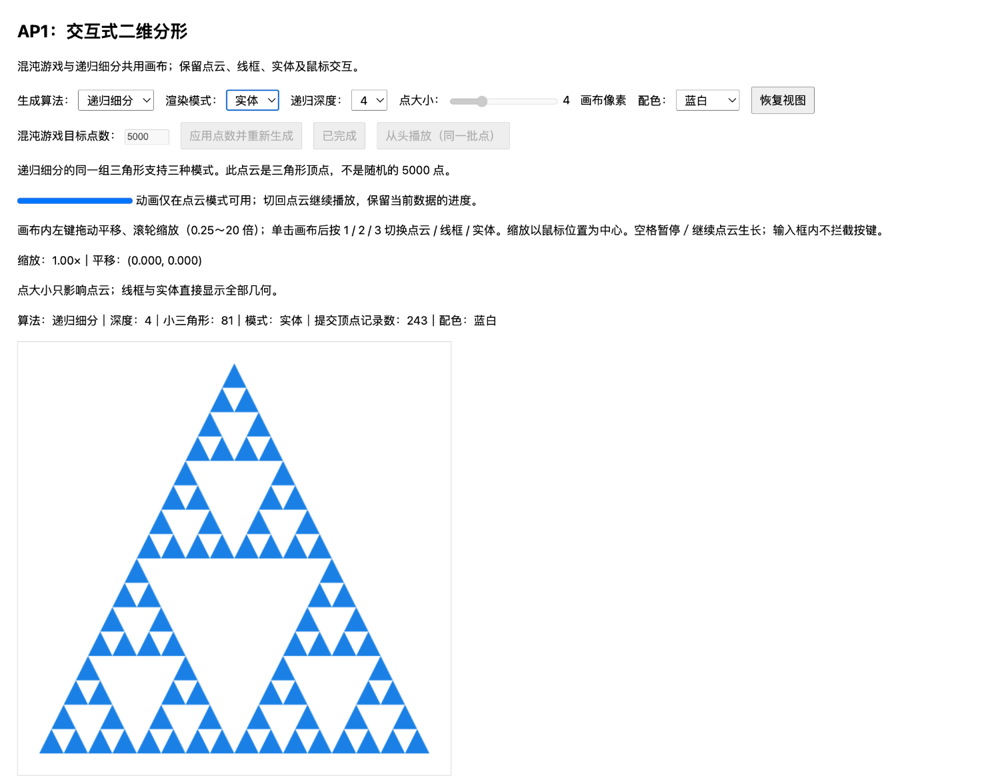

# AP1：交互式二维分形

> 提交稿｜2026-10-11。正式入口为 `index.html`；三种模式实测截图与 GitHub Pages 公网地址已归档，候选源码包已在全新目录完成独立解压与运行复验。正式源码包由当前最终提交使用 `git archive` 生成。

## 1. 项目简介

依据《课程项目说明书-Assigned-Projects.md》的“AP1 · 交互式 2D 分形”，使用原生 WebGL 2.0 与 JavaScript，在同一画布上展示混沌游戏与递归细分两种算法生成的 Sierpinski 垫片。递归结果支持点云、线框、实体三种渲染模式；页面提供显示参数、鼠标操作、键盘切换与逐点生长动画。

当前实现没有构建步骤。浏览器加载项目内脚本；`Common/initShaders.js` 用于编译、链接着色器。未引入 Three.js。

## 2. 运行方式与入口

使用支持 WebGL 2.0 的浏览器。先进入实际保存本项目文件的 `ap1` 目录，确认 `index.html` 与下列 JavaScript 文件都在其中，再启动静态服务器：

```bash
python3 -m http.server 8001 --bind 127.0.0.1
```

保持终端运行，在浏览器打开：

```text
http://127.0.0.1:8001/
```

这里的地址仅用于本机开发，不是提交用的公网地址。`index.html` 现在是完整 AP1 的正式入口；`legacy-chaos.html` 保留最初的静态混沌游戏示例，`recursive.html` 暂作为兼容入口保留。

**公网运行地址：** https://pigbabyye-art.github.io/computer-graphics-ap1/

**源码仓库：** https://github.com/pigbabyye-art/computer-graphics-ap1

## 3. 文件职责

| 文件 | 职责 |
|---|---|
| `index.html` | 正式入口；统一页面、参数控件、画布、顶点与片元着色器 |
| `recursive.html` | 兼容入口；当前内容与正式页面保持一致 |
| `geometry.js` | 中点、三角形内随机初始点、混沌游戏、递归细分、渲染数据转换 |
| `recursive-render.js` | WebGL 2.0 初始化、缓冲区、uniform 设置和绘制调用 |
| `recursive-ui.js` | 连接算法、控件、绘图与动画，维护当前数据及状态提示 |
| `recursive-interaction.js` | 左键拖动、滚轮缩放、数字键、空格回调、视图恢复 |
| `point-growth.js` | 按时间计算可见顶点记录数，控制暂停、继续和重播 |
| `Common/initShaders.js` | 教材配套着色器工具 |
| `legacy-chaos.html`、`render.js` | 保留的早期静态混沌游戏示例 |

## 4. 两种生成算法

### 4.1 混沌游戏

代码位置：`geometry.js` 的 `randomPointInTriangle()` 与 `generateChaosPoints()`。

先在外层三角形内生成随机初始点。代码取两个随机数 `u、v`；当 `u + v > 1` 时，把它们替换为 `1-u、1-v`，然后计算 `A + u(B-A) + v(C-A)`。

每次迭代随机选择外层三角形的一个顶点 `V`，令新点为当前点 `P` 与 `V` 的中点：

```text
P_new = (P + V) / 2
```

保存新点，再将它作为下一次的当前点。当前页面接受 5000～50000 的整数目标点数，并以 `gl.POINTS` 绘制。5000 对应任务中的最低要求，50000 是当前程序的输入上限。

这不是每步重新独立地在三角形内选点；每个新点都依赖上一个点。当前实现不丢弃预热迭代。有限数量的随机点是对分形的近似展示。

### 4.2 递归细分

代码位置：`geometry.js` 的 `subdivide(triangle, depth)`。

深度为 0 时直接返回当前三角形。否则计算三条边的中点，递归处理三个角上的小三角形，不生成中间的小三角形。每次递归深度减 1。

深度为 `d` 时，叶子三角形数量为 `3^d`。界面把深度限制为 0～6 的整数。该检查发生在 UI 调用递归之前；不应绕过输入检查任意调用负数或非整数深度。

递归输出是有限层次的小三角形列表；混沌游戏输出是一批迭代点。两者用不同方式近似同一分形，不要求两个有限结果逐点相等。

## 5. 三种渲染方式与数据传递

`buildRecursiveRenderData()` 从同一份递归三角形列表构造绘图数据。对于一个小三角形的顶点 `A、B、C`：

| 模式 | 顶点记录排列 | 每个小三角形的提交记录数 |
|---|---|---:|
| 点云 `gl.POINTS` | A、B、C | 3 |
| 线框 `gl.LINES` | A、B、B、C、C、A | 6 |
| 实体 `gl.TRIANGLES` | A、B、C | 3 |

线框要为 AB、BC、CA 三条边分别提供两个端点，不能仅更换图元类型而忽略数据排列。点云与实体复用同一份 `Float32Array`；坐标没有去重，提交记录数不等于不同坐标的数量。

坐标按 `x1, y1, x2, y2, …` 排列，通过 `gl.bufferData()` 复制到顶点缓冲区。`gl.vertexAttribPointer(..., 2, gl.FLOAT, ...)` 指定每两个浮点数组成一个二维位置，最后由 `gl.drawArrays()` 绘制。

在全部点显示完成时，深度 4 对应 81 个小三角形：点云与实体各 243 条顶点记录，线框 486 条端点记录。动画途中点云只提交当前已显示数量。

## 6. 交互操作

| 控件或操作 | 当前行为 |
|---|---|
| 生成算法 | 选择递归细分或混沌游戏；默认递归细分 |
| 渲染模式 | 递归支持点云、线框、实体；默认实体 |
| 混沌游戏下选线框／实体 | 自动明确切换到递归细分，并更新算法选择框 |
| 递归深度 | 0～6，默认 4；混沌游戏模式中禁用 |
| 目标点数与应用按钮 | 混沌游戏下读取 5000～50000 的整数，重新生成随机点并重置播放进度 |
| 点大小 | 默认 4 个画布像素，界面范围为 1～12 与设备支持范围的交集；只影响点云 |
| 三套配色 | 蓝白、橙黑、紫米白，同时改变图形色与画布背景色 |
| 左键拖动 | 平移图形，松开鼠标结束拖动 |
| 画布内滚轮 | 围绕鼠标位置缩放，当前范围 0.25～20 倍 |
| `1 / 2 / 3` | 切换点云／线框／实体；测试前单击画布 |
| 空格或暂停／继续按钮 | 暂停或继续当前点云动画；线框与实体不播放动画 |
| 从头播放（同一批点） | 把显示进度重置为 0，不重新随机生成坐标 |
| 恢复视图 | 缩放重置为 1、平移重置为零；不清除模式、配色或动画进度 |

焦点在输入框、下拉框或按钮等控件中时，不拦截数字键和空格。鼠标模块不接管带 Ctrl／Command 等组合键的滚轮。切换到后台标签页主动暂停动画，返回后由使用者继续。

## 7. 视图变换与逐点生长

顶点着色器使用 `P' = sP + T`，即先缩放、再平移。`uScale` 与 `uTranslation` 改变显示位置，不修改几何算法生成的原始坐标。`uPointSize` 控制小点自身的尺寸，和整体缩放相互独立；`uColor` 控制图形颜色。

`point-growth.js` 使用 `requestAnimationFrame()` 回调时间差，按以下方式累计进度：

```text
progress = min(total, progress + rate × elapsedSeconds)
visibleCount = floor(progress)
```

当前速度为每秒 500 点。新数据从 0 开始显示，绘图模块每帧只绘制数组前 `visibleCount` 个顶点。暂停保留进度，继续时重新建立时间基准，不累计暂停时长。完成后停在目标总数；重播复用同一批坐标。

在同一数据集内，换模式保留当前点云进度，回到点云时继续。切换到另一种算法或另一份数据时重置显示进度。混沌游戏的具体坐标只在生成新数据时改变，不在每帧重新随机生成。

## 8. 运行截图与验证状态

2026-10-11 已在本机 Chrome 中完成递归深度 4 的三种模式实测截图。三张图均使用蓝白配色、点大小 4、缩放 1.00×、平移 `(0.000, 0.000)`，并保留算法、深度、模式、提交记录数和完整画布。图片来自实际运行页面，未使用生成图片替代。

### 8.1 点云模式

递归深度 4，共 81 个小三角形；动画完成后提交 243 条顶点记录。



### 8.2 线框模式

递归深度 4，共 81 个小三角形；三条边分别提供两个端点，共提交 486 条端点记录。



### 8.3 实体模式

递归深度 4，共 81 个小三角形；每个小三角形使用三个顶点，共提交 243 条顶点记录。



三张截图的文件名和相对路径已固定，部署时应保持 `screenshots/` 与 `README.md` 的相对目录关系不变。

已有其他过程证据：本机截图显示过 5000 点混沌游戏；深度 4 和 6 的计数分别得到 81 和 729。使用者先后反馈“交互正常”“动画正常”，属于本机自测反馈。2026-10-11，项目已部署至 GitHub Pages，公网根地址指向完整的 `index.html` 应用；候选源码包也已解压到全新目录，并通过独立静态服务器运行复验。

## 9. 来源与辅助工具说明

任务依据为课程提供的《课程项目说明书-Assigned-Projects.md》通用要求及 AP1；算法、交互和参数描述对应本目录实际代码。

`Common/initShaders.js` 来自 Angel & Shreiner《Interactive Computer Graphics》第8版配套工具目录。会话中的下载命令记录了以下地址：

```text
https://www.interactivecomputergraphics.com/8E/Code/Common/initShaders.js
```

开发过程中使用 ChatGPT 辅助讲解、代码示例、部分实现编写、文件整合及调试；当前实现包含 AI 提供的代码，使用者进行了本机集成与功能测试。不将该过程表述为全部代码均未经辅助独立撰写。AI 辅助代码的使用范围及引用形式仍需依课程要求向任课教师确认；注明来源不能代替教师关于独立完成的规定。当前没有已执行 Codex 任务的记录，不声称本项目由 Codex 实现或测试。

## 10. 最终交付状态

- [x] 正式入口为仓库根目录的 `index.html`，GitHub Pages 公网根地址已由使用者实际打开并确认可运行。
- [x] 点云、线框、实体三张实测截图已归档并嵌入 README。
- [x] 候选源码包已在全新目录解压，并通过独立静态服务器完成运行复验。
- 正式源码包文件名：`computer-graphics-ap1-final.zip`，由最终提交使用 `git archive` 生成。
- [ ] 按课程要求确认 AI 辅助代码的允许范围与引用方式，并准备现场解释关键算法与数据传递流程。

E1～E3 选做扩展当前未实现，本文不将它们列为已完成功能。
